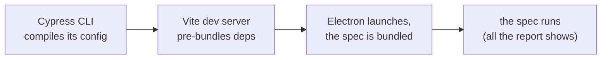

import {
  Wide,
  Scroll,
  TestSetup,
  CodeTabs,
  SplitModes,
  ScaleChart,
  WallBreakdown,
  TaskTimeline,
  StartupTaxChart,
  RunnerChart,
  TaskCountChart,
  SetupMetricChart,
  AgentsRunBars,
  AgentTimeChart,
} from '../../../src/components/nx-bench';
import { runs, tax, timelines, limits, agents } from './data';

Nx can run a test project in three ways: as one task, as one task per spec file, or as a few groups of specs. Smaller tasks run more in parallel, but each one has to start its test runner first.

I measured this with Cypress, Playwright and Vitest, on one machine and on Nx Agents. I also tested a common claim: atomization shines when some tests are much slower than the others.

## Three ways to split a project

Sharding and atomization both add a `-ci` target. It runs nothing itself, it just depends on its pieces:

<SplitModes />

With 4 tasks in parallel, one long task leaves most of the parallelism unused. Sharding runs 3 tasks in parallel for only 3 startups, so it finishes first. Atomization uses all 4, but pays 12 startups and ends later.

## The setup

One generated workspace in three sizes, run on one machine with two workloads:

<TestSetup
  items={[
    ['Workspace', '12, 50, 100 projects', '~20 specs per project'],
    ['Runners', 'Cypress, Playwright, Vitest', 'component, e2e and unit tests'],
    ['Quick specs', '~1 s per spec', '~0.2 s for Vitest'],
    ['Slow projects', '1 project in 5 is slow', '15 s per spec, 3 s for Vitest'],
    ['Parallelism', '--parallel=8', 'up to 8 tasks at once'],
    ['Machine', 'Ryzen 9 9950X3D', '16 cores, 32 threads, 64 GB'],
    ['Runs', '87 valid runs', 'one per configuration'],
  ]}
/>

The two workloads answer different questions:

- **Quick specs:** every project is about the same size, and every spec takes about a second. It's a clean, even workload, good for measuring the cost of each split.
- **Slow projects:** one project in five gets much slower specs, about 15 s each instead of 1 s. That's closer to a real workspace, where a few big projects, like a large app's component tests, take much longer than the rest and decide when the run ends.

Only the `plugins` in `nx.json` change between setups:

<CodeTabs
  labels={['Default', 'Sharded', 'Atomized', 'Shard plugin', 'Run']}
  notes={[
    "The Nx plugins without their atomizers. Playwright atomizes unless its ciTargetName is empty.",
    "The default plugins, plus one shard plugin per runner. Projects too small to split delegate to their whole-project target.",
    "A CI target name on each plugin turns its atomizer on. The target default lets Cypress atoms run in parallel; @nx/cypress runs them one at a time by default.",
    "How the plugin splits a project: estimate its runtime from its spec sizes, then fill ceil(estimate / target) shards, heaviest spec first into the lightest shard.",
    "Every project depends on the shared library the commit changes, so all of them run. NX_PROFILE records when each task starts and ends.",
  ]}
>

```json
{
  "plugins": [
    {
      "plugin": "@nx/cypress/plugin",
      "options": { "componentTestingTargetName": "component-test" }
    },
    {
      "plugin": "@nx/playwright/plugin",
      "options": { "targetName": "e2e", "ciTargetName": "" }
    },
    {
      "plugin": "@nx/vitest",
      "options": { "testTargetName": "test", "testMode": "run" }
    }
  ]
}
```

```json
{
  "plugins": [
    // ...the three default plugins, then:
    {
      "plugin": "./tools/shard-plugin/src/cypress-ct.ts",
      "options": {
        "ciTargetName": "component-test-ci",
        "delegateTarget": "component-test"
      }
    },
    {
      "plugin": "./tools/shard-plugin/src/playwright.ts",
      "options": { "ciTargetName": "e2e-ci", "delegateTarget": "e2e" }
    },
    {
      "plugin": "./tools/shard-plugin/src/vitest.ts",
      "options": { "ciTargetName": "test-ci", "delegateTarget": "test" }
    }
  ]
}
```

```json
{
  "plugins": [
    {
      "plugin": "@nx/cypress/plugin",
      "options": {
        "componentTestingTargetName": "component-test",
        "ciComponentTestingTargetName": "component-test-ci"
      }
    },
    {
      "plugin": "@nx/playwright/plugin",
      "options": { "targetName": "e2e", "ciTargetName": "e2e-ci" }
    },
    {
      "plugin": "@nx/vitest",
      "options": { "testTargetName": "test", "testMode": "run", "ciTargetName": "test-ci" }
    }
  ],
  "targetDefaults": {
    "component-test-ci--*/**": { "parallelism": true }
  }
}
```

```ts
const estimatedSeconds = (totalBytes / 1024) * secondsPerKb;
const shardCount = Math.min(
  Math.ceil(estimatedSeconds / targetShardSeconds),
  maxShards,
  specs.length,
);

for (const spec of [...specs].sort(byBytesDesc)) {
  const lightest = shards.reduce((min, shard) => (shard.bytes < min.bytes ? shard : min));
  lightest.bytes += spec.bytes;
  lightest.paths.push(spec.path);
}
```

```sh
# The default runs -t component-test,e2e,test.
# Atomized targets are meant for Nx Cloud; local runs skip Nx 23.3's check.
NX_PROFILE=profile.json NX_SKIP_ATOMIZER_VALIDATION=true \
  nx affected -t component-test-ci,e2e-ci,test-ci --parallel=8 --skip-nx-cache
```

</CodeTabs>

The workspace generator, the shard plugin and the results are in the repository:

<div style={{ margin: '2.25em 0' }}>
  <GitHubRepo name="edbzn/nx-atomization-vs-sharding" />
</div>

## Results

Sharding is the fastest setup in both workloads:

<ScaleChart runs={runs} />

Switch the workload above:

- **Quick specs:** sharding halves the run at 12 projects and ties the default from 50 projects up. Atomization is the slowest from 50 projects up.
- **Slow projects:** the default is by far the slowest. Atomization beats it, but sharding is faster still, at every size.

### Why splitting helps: unused parallelism at the end

Each run has two parts. The **work** is how long the run would take if 8 tasks always ran. The **idle tail** is the extra time when fewer than 8 run, mostly at the end.

<WallBreakdown limits={limits} runs={runs} parallelSwitch={false} />

Splitting shrinks the tail but adds startups:

- **Quick specs:** at 12 projects, sharding removes a long tail and adds only a few seconds of work. From 50 projects up, the default's tail is already short, so there's little to gain.
- **Slow projects:** the default spends a large part of its run in the tail. Both splits remove it, and then atomization's extra startups make it slower than sharding.

The timeline shows the tail task by task. With slow projects at 12 projects, one big Cypress project runs alone for the last 284 s:

<TaskTimeline timelines={timelines} />

Both splits use nearly all the parallelism. The default leaves much of it unused, most of all with slow projects:

<SetupMetricChart runs={runs} metric="parallelism" />

The reason is the longest task. In the default, it's a whole project, and the run can't end before it does. Sharding cuts it down to a shard, atomization to a single spec:

<SetupMetricChart runs={runs} metric="longest" />

### Every extra task pays a startup

For the same specs, each setup runs a very different number of tasks:

<TaskCountChart runs={runs} />

Each of these tasks starts its runner first. Before its spec runs, a Cypress component-test atom does all this:

<Wide>



</Wide>

<StartupTaxChart tax={tax} />

The startup is the same with quick or slow specs. Cypress pays the most, almost 3 s per task.

<Note type="warning">These startups belong to this workspace on this machine; yours can be several times longer. Measure them: run one project as a single task, then as atoms, and compare.</Note>

These startups explain almost all the gap between atomization and sharding. At 100 projects with quick specs, atomization runs about 1,500 more tasks than sharding. Their startups add about four minutes, and that's how much later it finishes.

So the runner decides what a split costs:

<RunnerChart runs={runs} />

- **Cypress:** atomization is always slower than sharding, because every Cypress task starts slowly.
- **Playwright and Vitest:** their startups are cheap, so atomization can win at 12 projects, where parallelism would otherwise go unused.

### Memory stays the same

More, smaller tasks don't need more memory. With 8 tasks at a time, every setup uses about 8 GB at its busiest:

<SetupMetricChart runs={runs} metric="memory" />

### Distributed on Nx Agents

Everything above ran on one machine. Here, Nx Cloud runs the slow-projects workspace with 100 projects across 8 CI agents. Compare the setups with each other, not with the local results.

<TestSetup
  items={[
    ['Workspace', '100 projects', 'slow projects workload'],
    ['Agents', '8', '4 vCPU, ~16 GB each'],
    ['Scheduling', 'Nx Cloud', 'distributes the tasks across agents'],
    ['Runs', '3', 'one per setup, no cache'],
  ]}
/>

**Agent boot** is the time from the start of the CI job until the first agent is ready. **Test time** is everything after that.

<AgentsRunBars agents={agents} />

- **Sharded is the fastest:** its tests take about 11 minutes.
- **Atomized comes second,** about 6 minutes behind sharding.
- **The default is the slowest,** because its biggest project runs as one long task.
- **Agent boot is the same for every setup,** under 2.5 minutes.

That's the same order as on one machine.

<AgentTimeChart agents={agents} />

Sharding also uses the least agent time, and the default the most.

## Conclusion

With all runners together, sharding was the fastest or tied in every configuration: with quick specs and with slow projects, on one machine and on Nx Agents. It removes the idle tail for only a few startups.

Atomization removes the tail too, but pays a startup for every spec, so its runs end later. The default pays the fewest startups, but its biggest project decides when the run ends.

Speed isn't the only reason to atomize. On Nx Cloud, atoms also bring per-spec retries and flaky-test detection, which this benchmark didn't measure.
